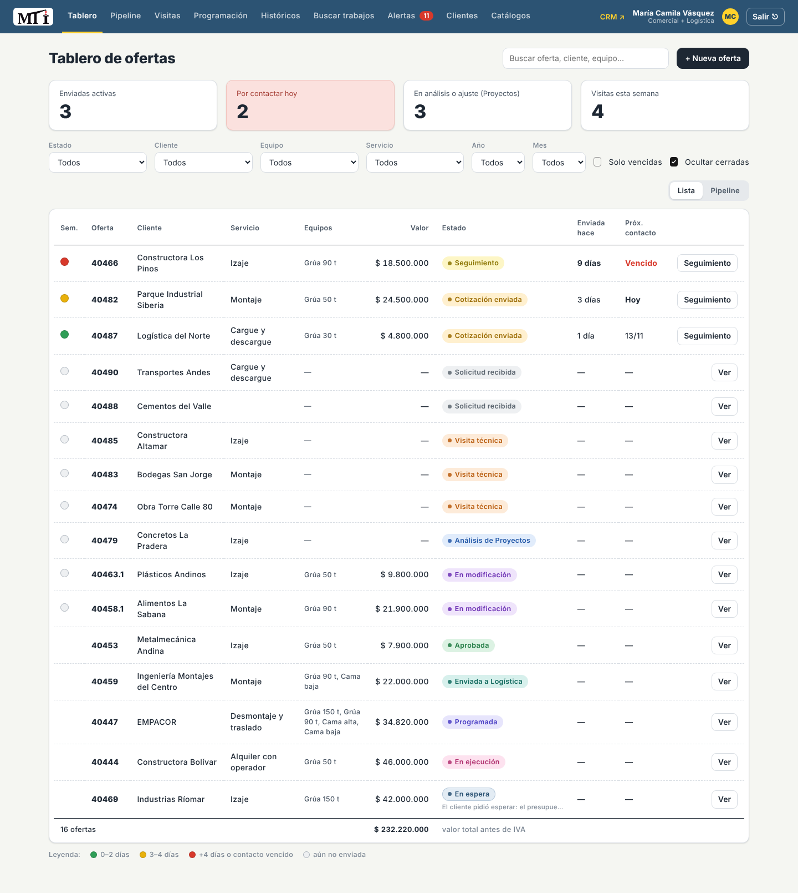
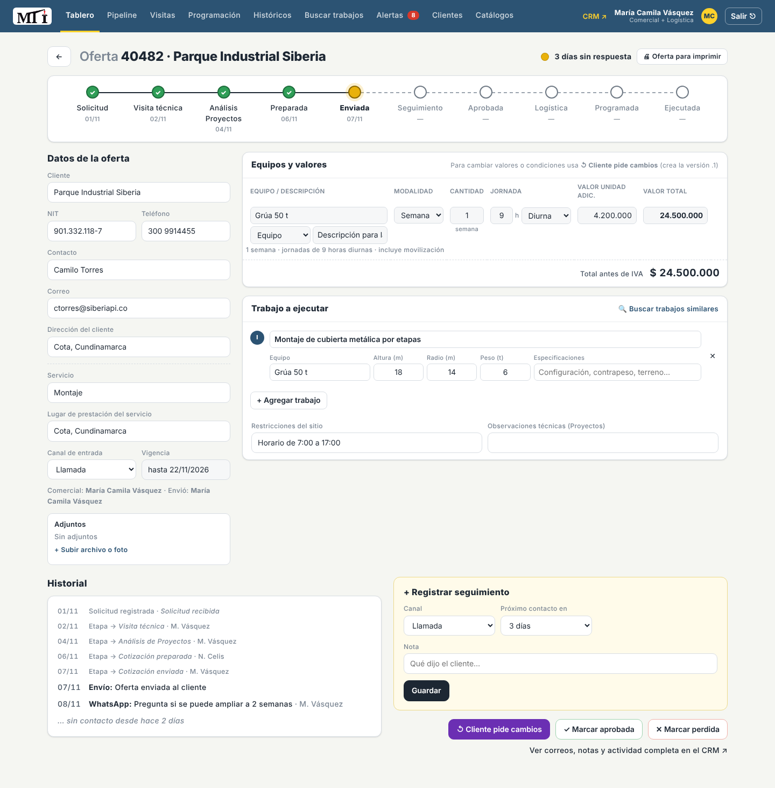
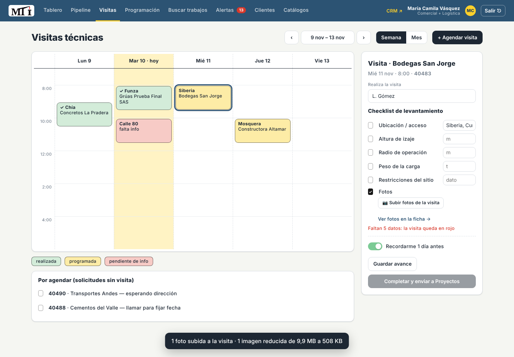
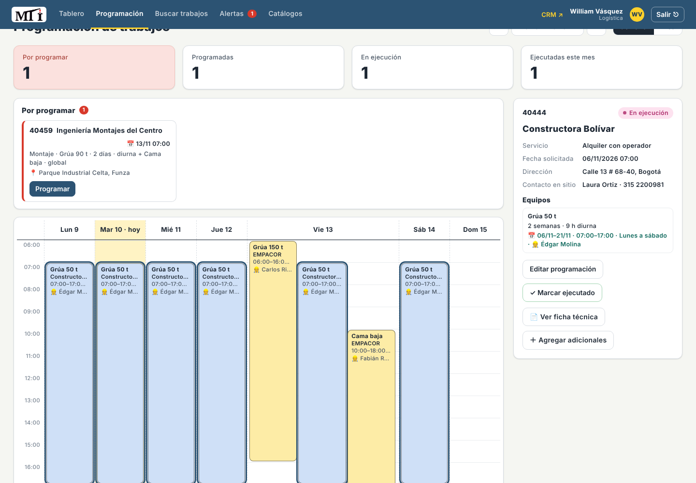
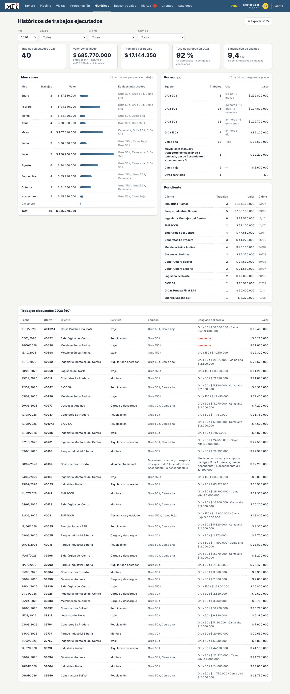

# MTI Grúas · Trazabilidad de ofertas y visitas técnicas

Sistema para **Montajes Telescópicos Industriales SAS (MTI Grúas)** que registra cada oferta desde que
llega la solicitud hasta que el servicio se ejecuta, la pasa automáticamente entre Comercial, Proyectos y
Logística y avisa cuando algo se atrasa. Está construido sobre **[Frappe CRM](https://github.com/frappe/crm)**
(código abierto), usando solo elementos estándar, para que MTI pueda mantenerlo sin un área de TI.

**En producción:** https://mtigruas.v.frappe.cloud/mti (Frappe Cloud · Frappe 16 + Frappe CRM)



## Flujo

```
Solicitud recibida → Visita técnica → Análisis de Proyectos → Cotización preparada → Cotización enviada
      → Seguimiento → Aprobada → Enviada a Logística → Programada → En ejecución → Ejecutada
                   ↘ En modificación (el cliente pide cambios) ↗          ↘ Perdida / Cancelada
        (cualquier etapa abierta) ⇄ En espera (con motivo y fecha para retomar)
```

Cada área tiene su propia pestaña de **alertas** (Comercial, Análisis de Proyectos, Logística) para que no
se olviden cotizaciones, análisis ni programaciones.

| Perfil | Qué hace en el sistema |
|---|---|
| Comercial – Cotizaciones | Registra solicitudes y clientes, agenda visitas, elige qué servicios cotizados van en la oferta final, ajusta el texto de la oferta antes de imprimirla, hace seguimiento con semáforo, aprueba y pasa a Logística |
| Dirección de Proyectos | Define la solución técnica: equipos, modalidad, valores, trabajos (altura, radio, peso) y sube el diagrama de Compu Crane; ve todas las vistas |
| Logística | Programa equipos y operadores, registra adicionales (horas/días extra, otros cobros), el reporte diario, la calificación del cliente y el desglose del precio, y cierra los servicios |
| Gerencia | Consulta todas las vistas, históricos, indicadores y satisfacción de clientes; exporta clientes (solo lectura) |

## Novedades de la versión final (v3.1)

| Cambio | Cómo se usa |
|---|---|
| **Servicios seleccionados** | En la ficha, cada equipo cotizado tiene una casilla ✓. Solo los marcados van en la oferta al cliente; el total de la ficha suma solo los marcados y es **solo para Comercial**. Se puede cambiar hasta que el cliente aprueba |
| **Oferta al cliente sin totales y editable** | *🖨 Oferta para imprimir* parte de la plantilla MTI-CL-FR-002 **sin filas de total**. Comercial hace clic en el documento, ajusta el texto y pulsa **Guardar texto**; **Restablecer plantilla** lo vuelve a generar con los datos actuales |
| **Alerta de desglose → Logística** | "Registrar el desglose del precio" aparece en la pestaña Logística de Alertas |
| **Eliminar clientes (solo administrador)** | Clientes → 🗑. Solo clientes sin ofertas; opcionalmente con sus contactos. Se recupera en `/app/deleted-document` |
| **Cambios en vivo** | Sin recargar la página: cada 30 segundos `/mti` revisa si alguien cambió una oferta o una tarea y actualiza el Tablero, las Alertas y el contador; las alertas nuevas avisan con 🔔 y el número sale en la pestaña del navegador |
| **Preparado para ~1.500 ofertas/año** | Carga las ofertas abiertas y las de este año y el anterior; los años anteriores se traen al elegirlos. Tras cada acción solo se relee esa oferta |

## Pantallas

| | |
|---|---|
|  Ficha de la oferta con barra de etapas |  Calendario de visitas y checklist |
|  Programación de Logística |  Históricos e indicadores |

## Cómo está hecho

- **Datos y permisos**: Frappe CRM estándar (Negocios = ofertas, Organizaciones = clientes, Productos =
  equipos y líneas, Tareas).
- **Configuración**: campos personalizados `mti_*`, 15 etapas (incluida *En espera*), 5 doctypes de configuración y 13
  **Automatizaciones** de Frappe 16 (traspasos entre áreas, semáforo y recordatorios).
- **Pantallas de trabajo `/mti`**: una Página web de Frappe con `mti_app.js` y `mti_app.css`, que solo usa
  la API REST estándar.
- **Sin** app propia, **sin** Server Scripts y **sin** cambios al código de Frappe: las actualizaciones
  de Frappe Cloud no lo rompen.
- **`mti_instalar.py`** configura cualquier sitio Frappe CRM (local o en la nube) en pocos minutos.

## Inicio rápido (local, con Docker)

```bash
docker compose up -d                       # 1.ª vez: 10–15 min
docker compose logs -f frappe              # esperar "Running on http://0.0.0.0:8000"
docker compose exec frappe python3 /workspace/mti_instalar.py --usuarios-demo
docker compose exec frappe bash -lc "cp /workspace/mti_demo.py frappe-bench/apps/crm/crm/ && cd frappe-bench && bench --site crm.localhost execute crm.mti_demo.cargar"
```

Abrir http://localhost:8000/mti

| Usuario (solo local) | Perfil | Clave |
|---|---|---|
| `mcamila@mti.demo` | Comercial – Cotizaciones (+ Logística) | `Mti.2026!` |
| `ncelis@mti.demo` | Dirección de Proyectos | `Mti.2026!` |
| `wvasquez@mti.demo` | Logística | `Mti.2026!` |
| `mcelis@mti.demo` | Gerencia (solo consulta) | `Mti.2026!` |
| `Administrator` | Administrador | `admin` |

La primera vez con una carpeta nueva Docker instala todo desde cero: el instalador solo funciona cuando
los registros muestran *Running on http://0.0.0.0:8000*.
Apagar: `docker compose stop` · encender: `docker compose start` · borrar todo lo local: `docker compose down -v`.

## Producción (Frappe Cloud)

El despliegue desde cero está en [docs/04-despliegue-y-mantenimiento.md](docs/04-despliegue-y-mantenimiento.md#42-despliegue-desde-cero-referencia).

### Actualizar el sitio a una versión nueva

Primero se prueba en local; después, en producción:

```powershell
# 1. Copia de seguridad: Frappe Cloud → el sitio → Backups → Schedule Backup
# 2. Local (copiar los archivos nuevos encima de los de la carpeta del proyecto)
docker compose exec frappe python3 /workspace/mti_instalar.py --usuarios-demo
# 3. Producción, cuando ya se probó en local
docker compose exec frappe python3 /workspace/mti_instalar.py `
    --url https://mtigruas.v.frappe.cloud --usuario 'nacb@mtigruas.com' --clave 'CLAVE' --sin-catalogo
```

- El instalador **no borra ofertas, clientes, contactos ni comentarios**: agrega los campos nuevos,
  vuelve a publicar `/mti` y respeta la configuración que MTI ya cambió. Se puede correr varias veces.
- Solo cambios de pantallas: agregar `--solo-pantallas`.
- `--usuario` debe tener el rol **System Manager**. En PowerShell, la clave va entre **comillas simples**
  (con comillas dobles, un `$` en la clave se pierde y sale `401 · Invalid login credentials`).
- **Nunca en producción:** `--usuarios-demo` ni `mti_demo.py` (este último **borra todas las ofertas**
  para cargar la demostración).

## Documentación

| Documento | Para quién |
|---|---|
| [01 · Arquitectura](docs/01-arquitectura.md) | Visión técnica: componentes, decisiones, seguridad |
| [02 · Código](docs/02-codigo.md) | Desarrolladores: instalador, pantallas, cómo extender y publicar |
| [03 · Configuración de Frappe](docs/03-frappe.md) | Inventario de campos, etapas, automatizaciones, roles y formularios |
| [04 · Despliegue y mantenimiento](docs/04-despliegue-y-mantenimiento.md) | Administrador de MTI: usuarios, copias, cambios sin código, problemas frecuentes |
| [05 · Manual de uso](docs/05-manual-de-uso.md) | Usuarios: Comercial, Proyectos, Logística y Gerencia |
| Guía del administrador (documento aparte) | Persona no técnica que administra: plan y consumo, copias, usuarios, a quién pedir ayuda |

## Archivos

| Archivo | Qué es |
|---|---|
| `mti_instalar.py` | Instalador (Python 3, sin dependencias) |
| `mti_app.js`, `mti_app.css` | Pantallas `/mti` |
| `mti_logo_grande.png`, `mti_favicon.png` | Logo de MTI |
| `docker-compose.yml`, `init.sh` | Entorno local |
| `mti_demo.py` | Datos de demostración (solo local) |

## Licencia

El código de este repositorio se publica bajo la licencia **MIT** (ver [LICENSE](LICENSE)).
Frappe Framework (MIT) y Frappe CRM (AGPL-3.0) conservan sus propias licencias. El logo y los datos de la
empresa pertenecen a MTI Grúas.
