# 5. Manual de uso

> Para las personas que trabajan con el sistema todos los días: Comercial, Proyectos, Logística y
> Gerencia. No necesita conocimientos técnicos.

**Dirección:** https://mtigruas.v.frappe.cloud/mti · funciona en Chrome, Edge o Firefox, en el
computador o el celular.

---

## 5.1 Lo básico

### Entrar y salir
1. Abrir la dirección. Escribir el **correo** y la **clave** que entregó el administrador → *Continuar*.
2. Se abre directamente la pantalla de su perfil.
3. Para salir: botón **Salir** (arriba a la derecha).

Cambiar la clave: entrar a `https://mtigruas.v.frappe.cloud/app/user`, abrir su usuario → **Cambiar
contraseña**. Si la olvida, el administrador le pone una nueva.

### El encabezado

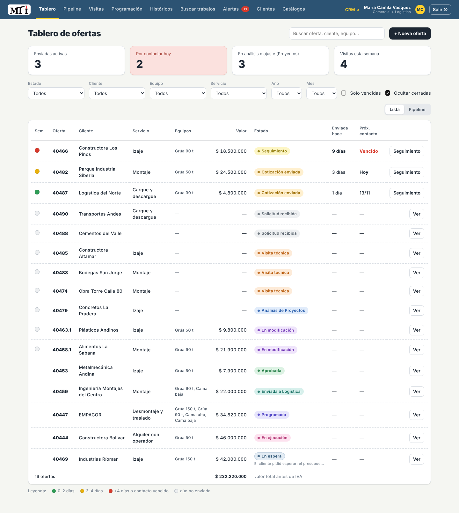

- **Logo y pestañas**: cada perfil ve solo las suyas.
- **Alertas** con un número rojo: cosas pendientes para hoy.
- **CRM ↗**: abre el CRM estándar de Frappe (correos, notas, actividad completa).
- **Nombre y perfil** del usuario y botón **Salir**.

### Qué ve cada perfil

| Pestaña | Comercial | Proyectos | Logística | Gerencia |
|---|:-:|:-:|:-:|:-:|
| Tablero | ✓ (inicio) | ✓ (inicio) | ✓ | ✓ |
| Pipeline | ✓ | ✓ | | ✓ |
| Visitas | ✓ | ✓ | | ✓ |
| Programación | | ✓ | ✓ (inicio) | ✓ |
| Históricos | | ✓ | | ✓ (inicio) |
| Buscar trabajos | ✓ | ✓ | ✓ | ✓ |
| Alertas | ✓ (Comercial) | ✓ (Proyectos) | ✓ (Logística) | ✓ (todas, consulta) |
| Clientes | ✓ (sin exportar) | ✓ + exportar | | ✓ + exportar |
| Catálogos | ✓ | ✓ | ✓ | ✓ (consulta) |

Una persona con dos perfiles (p. ej. Comercial + Logística) ve las pestañas y botones de ambos.
**Proyectos** y **Gerencia** ven todas las vistas; **Gerencia** no modifica nada. **Comercial y Logística no
ven Históricos ni pueden exportar clientes.**

### Cotización aprobada = fijada

Cuando una oferta se marca **Aprobada**, sus equipos, valores y condiciones **quedan fijados**: nadie puede
cambiarlos ni devolverla a etapas anteriores (si el cliente desiste, se usa *Cancelar servicio*). La
ficha lo indica con un aviso 🔒. Lo que cambie durante el servicio (horas extra, otro cobro) se registra
como **adicional** (ver 5.5).

### El semáforo

Aplica a las ofertas **enviadas al cliente** (Cotización enviada y Seguimiento):

| Color | Significa (valores por defecto) |
|---|---|
| 🟢 Verde | 0 a 2 días desde el envío |
| 🟡 Amarillo | 3 a 4 días |
| 🔴 Rojo | Más de 4 días, o se pasó la fecha de próximo contacto |
| ⚪ Gris | Todavía no se ha enviado |

Los días se ajustan en **Alertas → Reglas del semáforo**.

### En espera

Cualquier oferta abierta se puede **poner en espera** cuando depende de algo externo (el cliente aplaza la
obra, falta un permiso, falta un plano). Sale del flujo activo sin perderse:
- Se pide el **motivo** (obligatorio) y, si se quiere, una fecha para **retomarla**: ese día llega la
  alerta a Comercial.
- En el Tablero y en el Pipeline se ve con su color propio y el motivo debajo de la etapa.
- **▶ Reanudar** la devuelve exactamente a la etapa en que estaba.

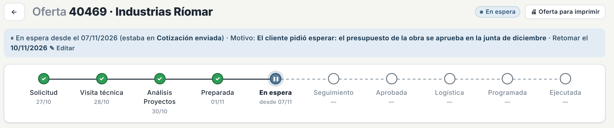

Las ofertas **perdidas** y **canceladas** también muestran su motivo en el Tablero y el Pipeline, y el
motivo se puede corregir después con **✎ Editar motivo** en la ficha.

### El código de la oferta

Cada oferta tiene un número consecutivo (**40482**). Si el cliente pide cambios después de enviada, se
crea una nueva versión con punto: **40482.1**, **40482.2**… Las versiones anteriores quedan guardadas.

---

## 5.2 El recorrido de una oferta

```
 COMERCIAL                     PROYECTOS                 COMERCIAL                         LOGÍSTICA
 ─────────                     ─────────                 ─────────                         ─────────
 1 Nueva oferta                                                                           
 2 Agendar visita              
 3 Checklist completo ───────► 4 Equipos y valores                                           
                                 "Análisis terminado" ──► 5 Enviar al cliente               
                                                          6 Seguimiento (semáforo)          
                               ◄── ajuste técnico ─────── 7 "Cliente pide cambios"          
                                                          8 "Marcar aprobada"               
                                                          9 "Enviar a Logística" ─────────► 10 Programar
                                                                                            11 Iniciar
                                                                                            12 Ejecutada
```

En cada paso **el sistema le crea una tarea a la persona siguiente** (la ve en Alertas y en el CRM), y la
barra de etapas de la ficha muestra en qué va la oferta y qué fecha tuvo cada paso.

---

## 5.3 Comercial – Cotizaciones

### 1. Registrar una solicitud nueva
1. **Tablero** → **+ Nueva oferta**.
2. Llenar:
   - **Cliente** (obligatorio). Al escribir, sugiere los clientes que ya existen; si es nuevo, se crea solo.
   - **Servicio** (Izaje, Montaje…), **Canal de entrada** (WhatsApp, Correo, Llamada, Referido),
     **Lugar de prestación del servicio** y **Nota inicial** (qué pidió el cliente).
   - **Requiere visita técnica**: dejarlo activo si hay que ir a la obra.
3. *Crear*. Se abre la ficha de la oferta en **Solicitud recibida**.

> Desde **Clientes** también se puede crear una oferta con el botón **+ Oferta** del cliente: el
> cliente queda precargado.

### 2. Agendar la visita técnica
1. En la ficha → **Agendar visita técnica** (o en **Visitas** → *+ Agendar visita*).
2. Fecha, hora y **técnico** que la realiza. Activar *Recordarme 1 día antes* si se quiere el recordatorio
   (llega como tarea en Alertas).
3. La oferta pasa a **Visita técnica** y aparece en el calendario de **Visitas**.

Si no hace falta visita: botón **Sin visita → Proyectos**.

### 3. Completar el checklist de la visita

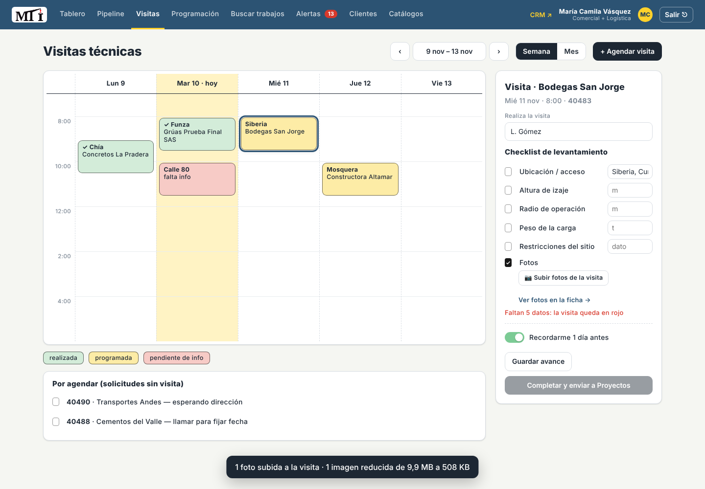

1. **Visitas** → clic en la visita del calendario. A la derecha (o debajo, si la semana está llena) se
   abre su ficha.
2. Marcar y llenar los 6 puntos: **ubicación/acceso, altura de izaje, radio de operación, peso de la
   carga, restricciones del sitio y fotos**. Las fotos se suben ahí mismo con **📷 Subir fotos de la
   visita** (desde el celular abre la cámara); se comprimen solas y marcan el punto *Fotos*.
3. **Guardar avance** si falta algo, o **Completar y enviar a Proyectos** cuando estén los 6.

> Las fotos se pueden subir directo desde el celular. El sistema las **reduce solo** antes de subirlas
> (una foto de 4 MB queda en unos 300 KB) para no llenar el espacio del plan; se siguen viendo bien.

Colores del calendario: verde = realizada, amarillo = programada, rosado = **pendiente de información**
(la fecha ya pasó y falta algo del checklist). Las visitas a la misma hora se ven lado a lado.
**Por agendar** muestra las solicitudes que necesitan visita y no tienen fecha.

### 5. Enviar la oferta al cliente
Cuando Proyectos termina, la oferta llega en **Cotización preparada** y le aparece la tarea
*"Formalizar y enviar"*.

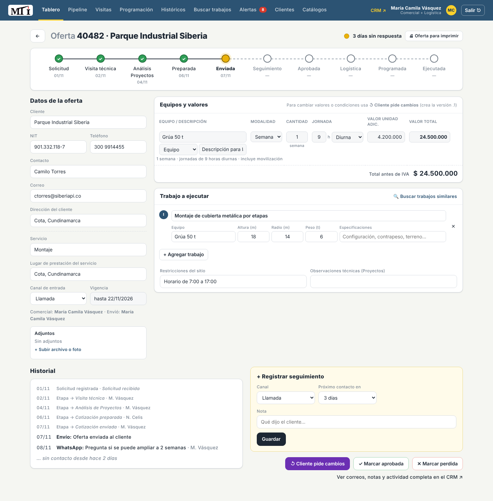

1. Abrir la oferta (Tablero o Alertas). Revisar **Equipos y valores** y **Trabajo a ejecutar**.
2. **Oferta para imprimir** → revisar el formato MTI-CL-FR-002 → **Imprimir / Guardar PDF** → enviar el
   PDF al cliente por el canal de siempre.

   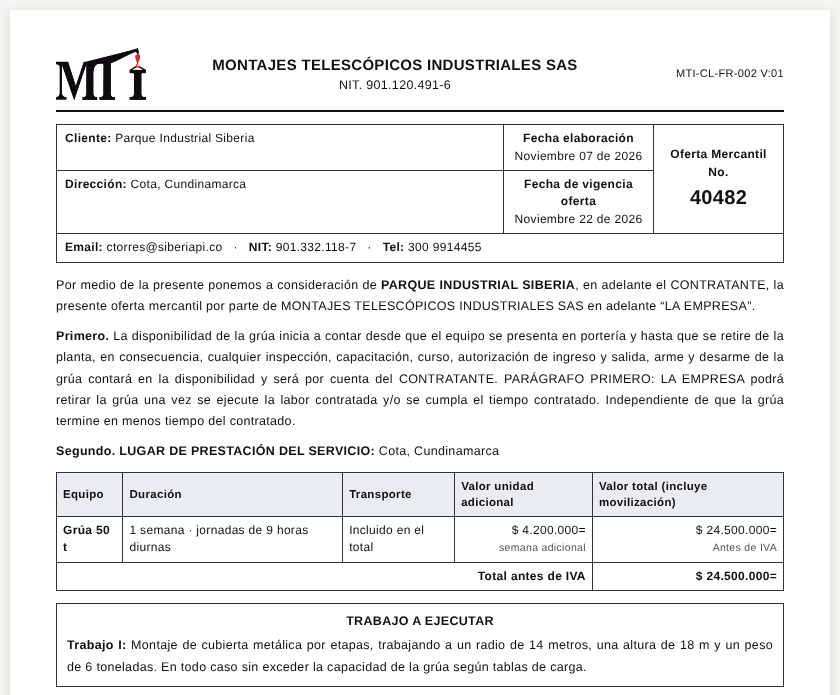

3. En la ficha → **Marcar como enviada al cliente**. El sistema guarda la fecha de envío, quién la envió,
   la **vigencia** (15 días) y el **próximo contacto** (3 días). Empieza el semáforo.

### 6. Hacer seguimiento
- En el **Tablero**, las ofertas con *Por contactar hoy* o *Vencido* tienen el botón **Seguimiento**.
- En la ficha, recuadro amarillo **Registrar seguimiento**: canal (Llamada, WhatsApp, Correo, Visita,
  Reunión), cuándo volver a contactar (días) y **qué dijo el cliente** → *Guardar*.
- Queda en el **Historial** de la oferta con fecha y nombre, y el semáforo se recalcula.

### 7. El cliente pide cambios
1. Ficha → **↺ Cliente pide cambios**.
2. Elegir el tipo:
   - **Comercial** (precio, condiciones): la oferta queda en **En modificación**; se ajustan los valores
     y se envía la nueva versión con **Enviar versión 40482.1 al cliente**.
   - **Técnico** (otro equipo, otra configuración): le llega a Proyectos la tarea *"Ajuste técnico"*;
     cuando termina, vuelve a **Cotización preparada** y se envía como en el paso 5.
3. Escribir **qué pidió el cliente**. La versión anterior queda guardada.

### 8. El cliente aprueba o no
- **✓ Marcar aprobada** → la oferta pasa a **Aprobada** y aparece la tarea *"Enviar a Logística"*.
- **✕ Marcar perdida** → elegir el **motivo** (precio, competencia, sin respuesta…) y un detalle. Si el
  cliente vuelve, la oferta se puede **Reabrir**. El motivo se puede corregir después con **✎ Editar motivo**.
- **⏸ Poner en espera** si el cliente pide aplazar la decisión: motivo y, si se sabe, fecha para retomar.

### 9. Enviar a Logística
1. Ficha → **Enviar a Logística →**.
2. Llenar: **fecha que solicitó el cliente**, hora, **dirección del servicio**, contacto y teléfono en
   sitio, y notas para Logística.
3. La oferta pasa a **Enviada a Logística** y Logística recibe la tarea *"Programar servicio"* con todos
   esos datos.

Si Logística cambia después la fecha de un servicio, Comercial recibe la alerta *"Fecha del servicio
cambió"* para avisarle al cliente.

### 10. Registrar el desglose del precio (al terminar el trabajo)

MTI cotiza con un **precio unificado** (por ejemplo $ 24.500.000 por grúa y transporte). Cuando el
servicio está **En ejecución** o **Ejecutada**, la ficha muestra el recuadro **Desglose del precio (para
históricos)**:

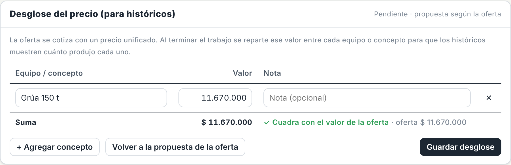

1. Viene una **propuesta** con los equipos de la oferta y sus valores.
2. Repartir el valor entre cada equipo o concepto: p. ej. *Grúa 50 t* $ 20.500.000, *Cama baja*
   $ 4.000.000. Con **+ Agregar concepto** se agregan otros (Transporte, Movilización, Operador…).
3. Abajo se ve si la suma **cuadra** con el valor de la oferta o cuánto falta o sobra.
4. **Guardar desglose**. Desde ese momento **Históricos → Por equipo** usa estos valores.

Los trabajos ejecutados en los últimos 30 días que no tienen desglose aparecen en las **Alertas de
Comercial**. Logística también puede registrarlo.

### Tablero: buscar y filtrar
- **Buscador** (oferta, cliente, equipo…) y filtros por **Estado, Cliente, Equipo, Servicio, Año y Mes**.
- **Solo vencidas**: las que ya pasaron su fecha de contacto. **Ocultar cerradas**: esconde Ejecutadas,
  Perdidas y Canceladas.
- Las 4 tarjetas de arriba también filtran al hacer clic (Enviadas activas, Por contactar hoy, En
  análisis o ajuste, Visitas esta semana).
- Botón **Pipeline** para ver las mismas ofertas en columnas por etapa. En el Pipeline las tarjetas **no se
  arrastran**: clic en la tarjeta para abrir la oferta y cambiar la etapa con sus botones.

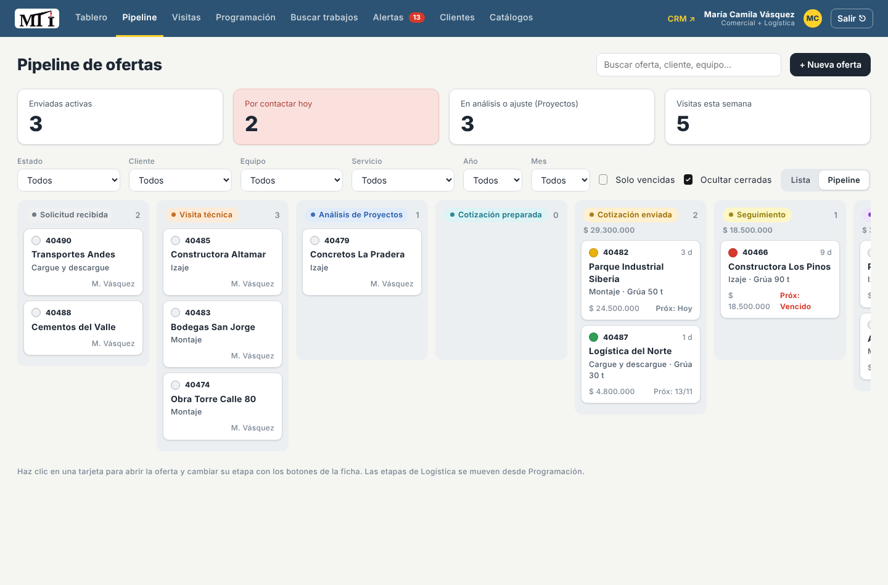

### Clientes

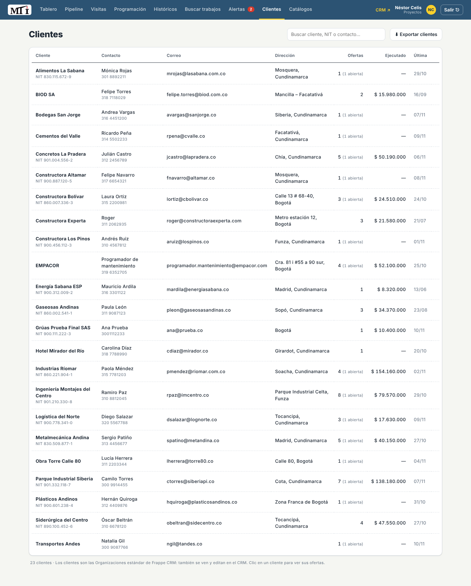

- Lista con buscador, número de ofertas, abiertas, valor ejecutado y fecha de la última oferta.
- **+ Nuevo cliente**: nombre, NIT, dirección, contacto, teléfono y correo.
- **Editar**: corregir los datos. **+ Oferta**: nueva oferta para ese cliente.
- Clic en la fila: muestra en el Tablero solo las ofertas de ese cliente.
- **Importar desde Excel ↗**: para cargar muchos clientes de una vez (descargar plantilla, llenarla,
  subirla).
- **⬇ Exportar clientes** (solo Proyectos y Gerencia): descarga todos los clientes con sus datos, número de
  ofertas, valor ejecutado y calificación promedio, en un archivo que abre Excel.

---

## 5.4 Dirección de Proyectos

### Recibir una oferta
Cuando Comercial completa el checklist (o la envía sin visita), Proyectos recibe la tarea **"Definir
solución técnica"**. Aparece en **Alertas** y en el Tablero en **Análisis de Proyectos**.

### Definir la solución técnica
1. Abrir la oferta. Revisar el levantamiento (checklist, fotos en Adjuntos, restricciones).
2. **Equipos y valores**: una línea por equipo o servicio:
   - **Equipo** (del catálogo; si no existe, se agrega solo al guardar) y tipo de línea (Equipo,
     Transporte, Otro), con una descripción si hace falta.
   - **Modalidad** (Hora, Día, Semana, Quincena, Mes, Global), **cantidad**, **horas por jornada** y
     **jornada** (Diurna, Nocturna, Mixta, 24 horas).
   - **Valor unidad adicional** y **valor total** (incluye movilización).
   - El total de la oferta se calcula solo.
3. **Trabajo a ejecutar**: uno o varios trabajos con equipo, **altura, radio y peso**, y
   especificaciones. Con **+ Agregar trabajo** se agregan más. Los máximos se calculan solos.
4. **Observaciones técnicas** y **restricciones del sitio**.
5. **Guardar cambios** cuantas veces quiera. Al terminar: **✓ Análisis terminado (Proyectos)**. La oferta
   pasa a **Cotización preparada** y Comercial recibe la tarea de enviarla.

> **🔍 Buscar trabajos similares** (en *Trabajo a ejecutar*) abre la búsqueda con la altura, radio y
> peso de esta oferta, para ver qué equipo se usó en trabajos parecidos y a qué precio.

### Devolver la oferta a Comercial
Cuando la oferta ya tiene equipos y valores pero sigue en *Análisis de Proyectos*, la alerta **"Devolver a
Comercial"** recuerda marcar **✓ Análisis terminado**: si no se marca, Comercial no puede enviarla.

Si falta información del cliente para terminar el análisis (un plano, un peso exacto), se puede
**⏸ Poner en espera** con el motivo; al llegar la información, **▶ Reanudar**.

### Subir el diagrama de Compu Crane
En **Trabajo a ejecutar**, abajo, está **Diagrama de izaje · Compu Crane** → **⬆ Subir diagrama (imagen o
PDF)**. Se ve en la ficha y, si es imagen, sale como anexo en la oferta impresa. Se puede reemplazar o
quitar mientras la cotización no esté aprobada. Las imágenes se comprimen solas (con buena resolución
para que se lean las medidas).

### Ajustes técnicos
Si el cliente pide un cambio técnico, llega la tarea **"Ajuste técnico"** con lo que pidió el cliente.
Se ajusta la oferta y se termina con **✓ Ajuste técnico terminado (Proyectos)**.

---

## 5.5 Logística

### Programación

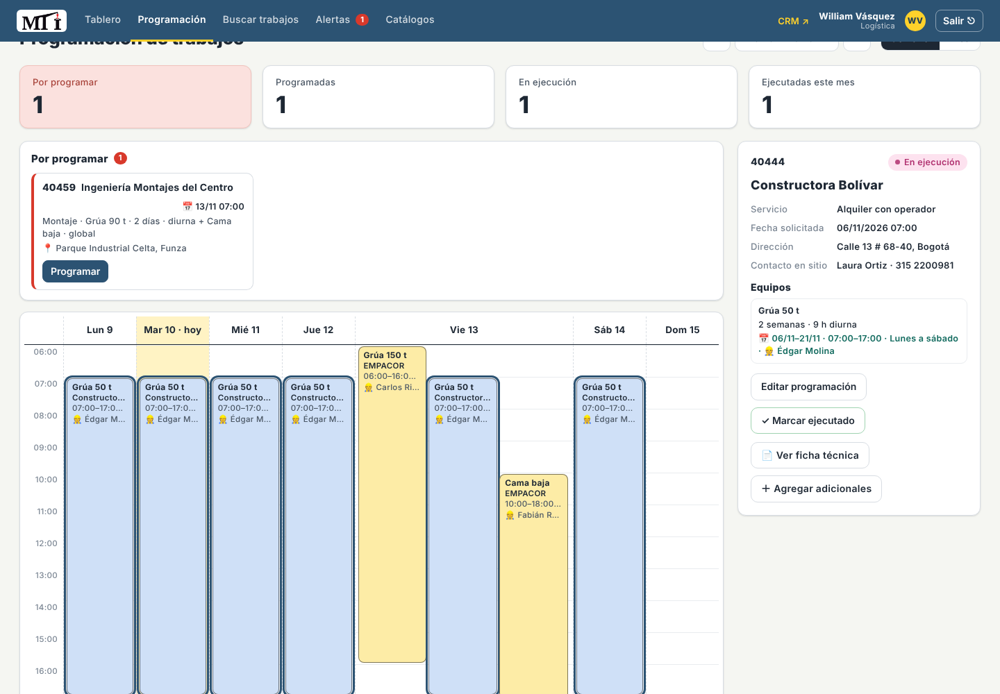

- **Semana**: columnas por día y filas por **horario** (06:00, 07:00…). Cada bloque es un equipo trabajando
  en un servicio, con cliente, horario, número de oferta y operador. Los trabajos que coinciden en el mismo
  horario se ven **lado a lado** (el día se ensancha). Un servicio de varios días aparece en cada día que
  trabaja según su frecuencia (lunes a viernes, lunes a sábado o todos los días).
- **Mes**: cada día con la lista de trabajos ordenada por hora.
- Si el **mismo equipo** queda en dos servicios a la misma hora, los bloques se marcan con **⚠** y sale un
  aviso arriba.
- **Por programar** (a la derecha): ofertas en *Enviada a Logística* con la fecha que pidió el cliente.
- Clic en un bloque: a la derecha sale el detalle del servicio con **📄 Ver ficha técnica** y
  **＋ Agregar adicionales**.

### Programar un servicio
1. Llega la tarea **"Programar servicio"** (Alertas) con cliente, servicio, fecha solicitada, dirección,
   contacto en sitio y equipos.
2. **Programación** → en **Por programar**, clic en la oferta → **Programar**.
3. Por cada equipo: **desde – hasta**, **hora de inicio – fin**, **frecuencia** (lunes a viernes, lunes a
   sábado, todos los días), **operador / conductor** y una nota.
4. *Guardar*: la oferta pasa a **Programada** y aparece en el calendario.

Si después se cambia la fecha, el sistema pide el **motivo del cambio**, cuenta la reprogramación y le
avisa a Comercial.

### Día del servicio
- El día anterior llega el recordatorio **"Servicio mañana"** (confirmar operador, movilización y
  permisos).
- **▶ Iniciar ejecución** cuando el equipo llega: pasa a **En ejecución**.
- **✓ Marcar ejecutado** al terminar: **fecha de ejecución** (es la que cuenta en Históricos) y
  observaciones.
- **Cancelar servicio** si el cliente lo cancela: pide el motivo; la oferta queda en **Cancelada**.
- **⏸ Poner en espera** si el cliente aplaza el servicio sin cancelarlo (desde *Enviada a Logística* o
  *Programada*).
- Al terminar, Logística (o Comercial) registra el **desglose del precio** del trabajo (ver 5.3, paso 10).

### Adicionales del servicio (antes de marcar ejecutado)
Con el servicio **En ejecución** (o ya ejecutado), la ficha muestra **Adicionales del servicio**:
- **+ Horas / días adicionales**: elegir el equipo; el tipo sale de la modalidad cotizada (horas, días,
  semanas…) y el valor por unidad del *valor unidad adicional* de la oferta. Se pone la cantidad y el
  motivo.
- **+ Cobro adicional**: cualquier otro cobro (escolta, parqueadero, cambio de ruta…) con su valor y motivo.
- Abajo se ve **Valor aprobado + Adicionales = Valor final consolidado**. **Guardar adicionales**.

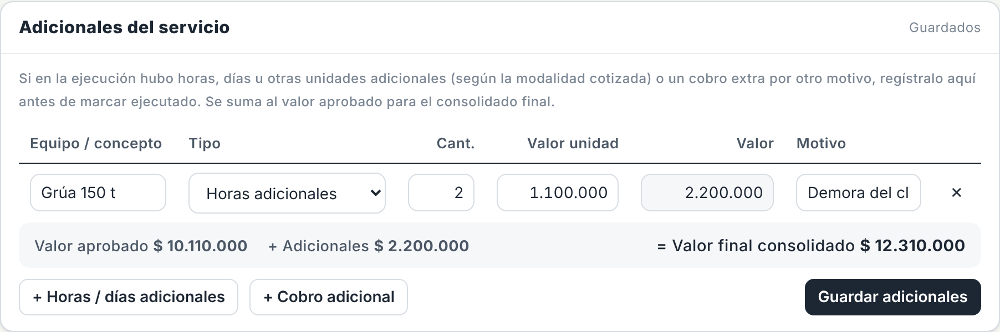

El valor final es el que cuentan los Históricos, el que se reparte en el desglose y el que aparece en la
oferta impresa como *Valor final consolidado*.

### Reporte diario y calificación del cliente
Al **✓ Marcar ejecutado** se abre una ventana con **📄 Ver ficha técnica**, los **adicionales** (se pueden
agregar ahí mismo con *+ Horas / días adicionales* o *+ Cobro adicional*, con el total final a la vista) y
los datos del **reporte diario** (formato MTI-CL-FR-001):

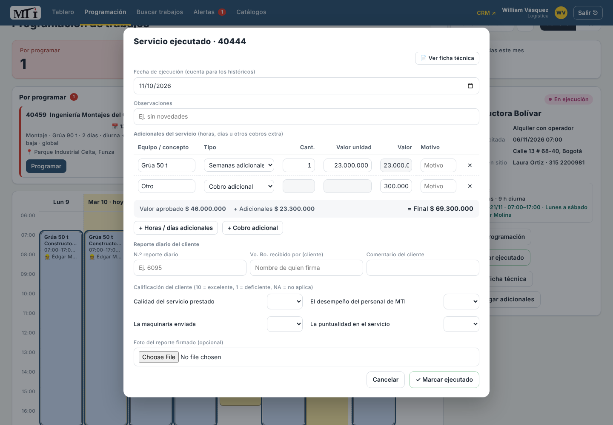

- **N.º de reporte diario** y **Vo. Bo. recibido por** (quien firma por el cliente).
- **Calificación del cliente** de 1 a 10 (o NA): calidad del servicio prestado, desempeño del personal de
  MTI, maquinaria enviada y puntualidad. El sistema calcula el promedio.
- Comentario del cliente y **foto del reporte firmado** (se comprime sola).

También se pueden completar o corregir después en la ficha → **Reporte diario y calificación del
cliente**. En Históricos aparece la **satisfacción promedio** de los clientes.

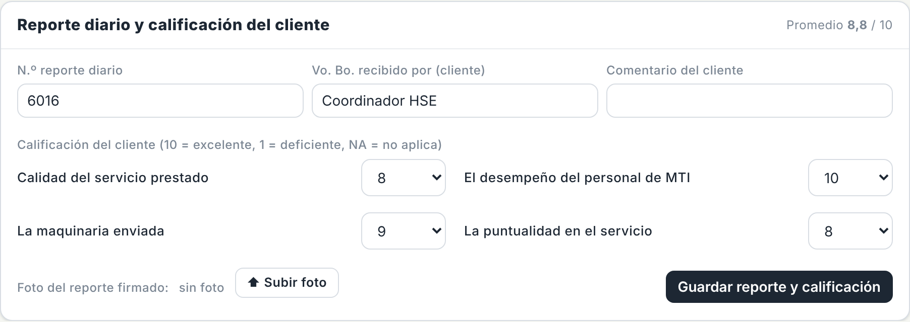

---

## 5.6 Gerencia

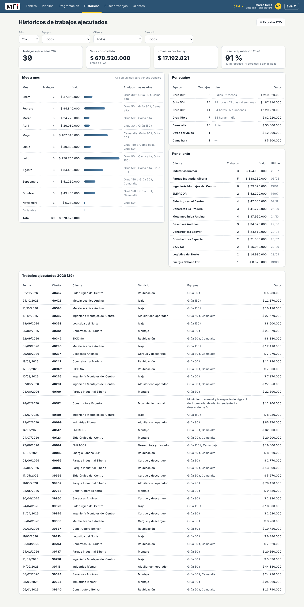

Gerencia entra a **Históricos** y puede recorrer todas las pestañas en modo consulta (sin botones de
edición).

### Históricos

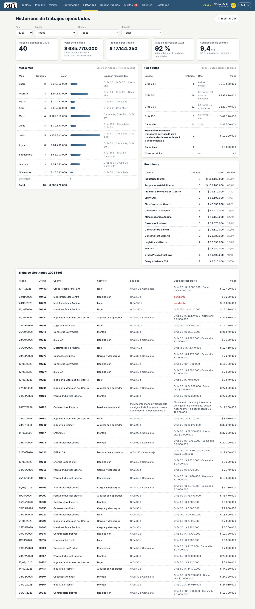

- Solo para **Proyectos y Gerencia**.
- Filtros por **año, equipo, cliente y servicio**.
- Tarjetas: trabajos ejecutados, valor consolidado (con adicionales), promedio por trabajo, **tasa de
  aprobación** (aprobadas frente a perdidas o canceladas) y **satisfacción de clientes**.
- **Mes a mes** (clic en un mes para ver sus trabajos), **por equipo** (cuánto se usó cada uno) y **por
  cliente**.
- Lista de trabajos ejecutados y **⬇ Exportar CSV** para abrirla en Excel.

### Buscar trabajos

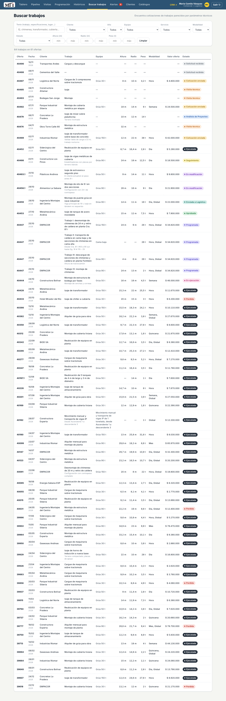

Búsqueda técnica sobre todas las ofertas: por texto, cliente, año, equipo, servicio, modalidad, estado y
rangos de **altura, radio y peso**. Sirve para responder "¿qué grúa usamos la última vez para levantar
6 t a 14 m?" y "¿a cuánto lo cobramos?".

---

## 5.7 Alertas por área

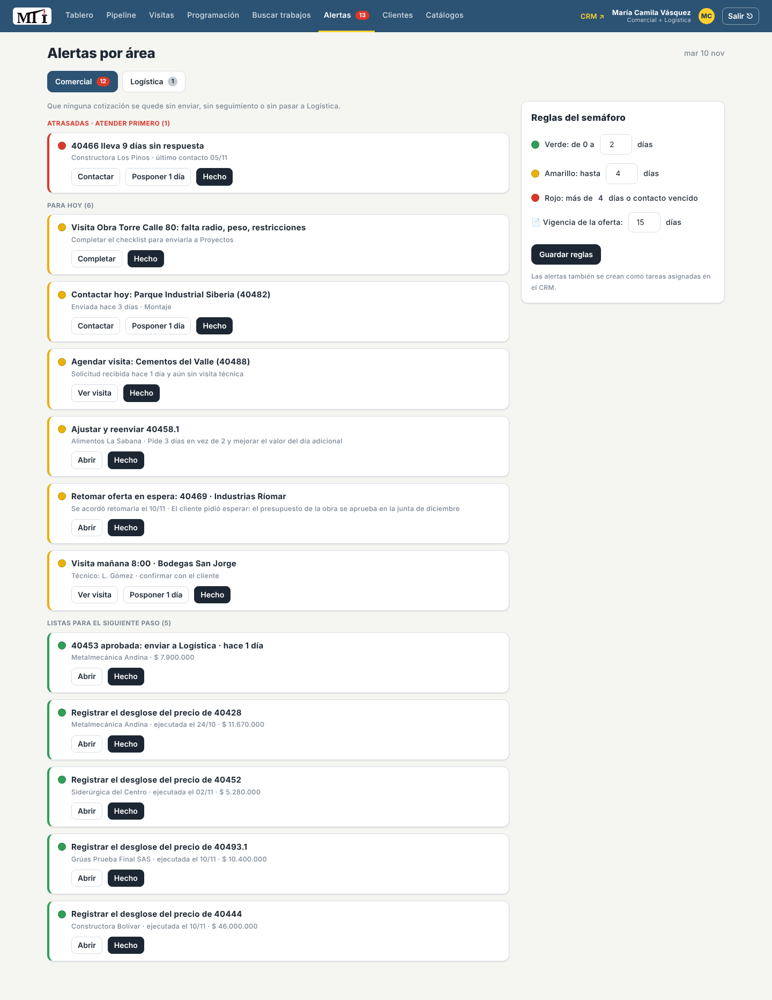

Cada área tiene **su propia pestaña de alertas**, con el número de pendientes. Cada persona ve las de su
perfil (quien tiene dos perfiles ve dos pestañas); Gerencia ve las tres en modo consulta. Dentro de cada
pestaña, las alertas se ordenan en **Atrasadas** (rojo, atender primero), **Para hoy** (amarillo) y
**Listas para el siguiente paso** (verde).

| Área | Objetivo | Alertas |
|---|---|---|
| **Comercial** | No olvidar cotizaciones | Ofertas en rojo sin respuesta · contactar hoy · vigencia vencida · solicitud sin visita agendada · visita mañana · checklist incompleto · **cotización preparada sin enviar** (roja si pasa 1 día) · ajuste comercial pendiente · **aprobada sin pasar a Logística** · oferta en espera que toca retomar · Logística cambió una fecha · trabajo ejecutado sin desglose de precio |
| **Análisis de Proyectos** | No olvidar análisis ni devolverlos a Comercial | Solución técnica por definir (roja después de 2 días) · **oferta con valores lista para devolver a Comercial** · ajuste técnico pedido por el cliente |
| **Logística** | No olvidar programaciones | **Servicio por programar** (rojo si espera más de 1 día o el cliente lo pidió para dentro de 2 días o menos) · servicio hoy · servicio mañana · servicio que debía iniciar y no se inició · servicio que ya terminó y no se marcó ejecutado |

Botones: **Contactar / Abrir / Ver visita / Abrir en Programación**, **Posponer 1 día** (seguimientos y
visitas) y **Hecho**.

> "Hecho" oculta la alerta **en ese computador**. Lo que realmente la resuelve es hacer la acción
> (registrar el seguimiento, programar, etc.): entonces desaparece para todos.

En la pestaña de Comercial, a la derecha, están las **Reglas del semáforo** (solo Comercial puede
cambiarlas): días en verde y amarillo, y días de vigencia de la oferta → *Guardar reglas*.

---

## 5.8 Catálogos

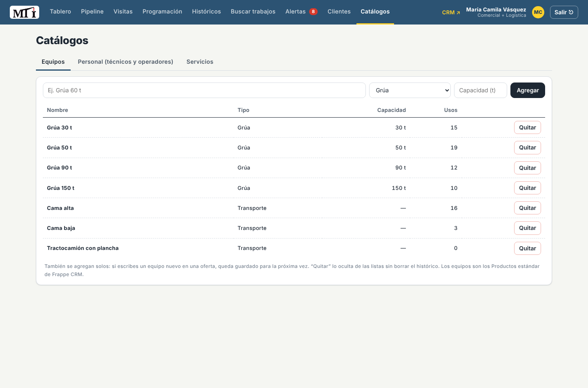

Tres listas: **Equipos** (grúas, camas, tractocamiones: nombre, categoría y capacidad), **Personal**
(técnicos de visitas, operadores, aparejadores, conductores) y **Servicios**.

- **Agregar** para crear uno nuevo.
- **Quitar** lo oculta de las listas, pero el historial de las ofertas que lo usaron no cambia.
- Además, cuando alguien escribe en una oferta un equipo, técnico o servicio nuevo, se agrega solo al
  catálogo.

---

## 5.9 El CRM estándar (`/crm`)

El botón **CRM ↗** abre Frappe CRM. Allí están las mismas ofertas (*Deals*), con las vistas **Tablero
MTI** y **Pipeline MTI**, los clientes (*Organizations*), contactos, tareas y notas. Es útil para ver la
**actividad completa** de una oferta (cada cambio con fecha y usuario) y, a futuro, para el correo.

> El trabajo del día a día se hace en **`/mti`**: ahí están las reglas del flujo (código de la oferta,
> totales, checklist, traspasos). Editar una oferta directamente en `/crm` guarda los datos, pero no
> recalcula esos campos hasta que se vuelva a guardar desde `/mti`.

---

## 5.10 Preguntas frecuentes

**¿Puedo trabajar desde el celular?** Sí, con el navegador del celular en la misma dirección. Para el
checklist y las fotos de la visita es lo más práctico.

**Me equivoqué de etapa, ¿cómo la regreso?** Comercial y Proyectos pueden cambiar la etapa desde la
ficha en los pasos simples; si no aparece el botón, pedirle al administrador que la corrija en `/crm`.

**¿Cómo se elimina una oferta?** Solo el **administrador del sistema** ve el botón **🗑 Eliminar oferta** en la
ficha. Pide escribir el número de la oferta para confirmar y borra también sus tareas, notas, comentarios y
adjuntos. Los demás usuarios no pueden eliminar ofertas: si una sobra, se marca *Perdida* o se le pide al
administrador.

**Borré algo sin querer.** El administrador puede restaurar documentos borrados en
`/app/deleted-document`.

**¿Por qué no veo un botón que mi compañero sí ve?** Porque tiene otro perfil. Si lo necesita, el
administrador le agrega el perfil.

**¿Qué diferencia hay entre "En espera", "Perdida" y "Cancelada"?** *En espera* es temporal: la oferta
vuelve a su etapa al reanudarla. *Perdida* es una oferta que el cliente no aceptó. *Cancelada* es un
servicio que se había aprobado y el cliente canceló. Las tres guardan su motivo.

**¿Dónde veo quién hizo cada cosa?** En el **Historial** de la ficha (y la actividad completa en
`/crm`).

**La pantalla se ve rara o como antes.** Recargar con **Ctrl+F5**.
